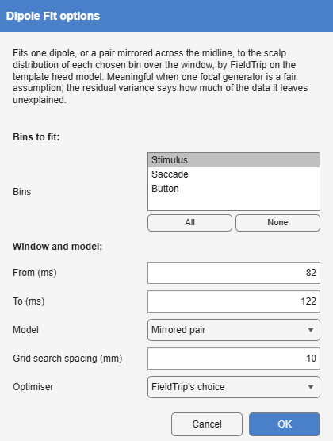
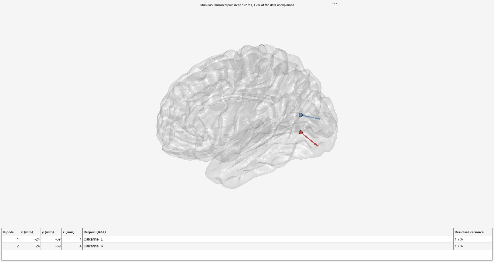

*Tools > 4. Frequency and Component Analysis > Dipole Fit · averaged →
averaged, with the fitted dipoles · `DipoleFit`*

An equivalent current dipole, or a pair mirrored across the midline, fitted
to a bin's scalp distribution over a time window: where one focal generator
(or one in each hemisphere) would have to be to produce it, and how much of
the data it then explains. The fit is FieldTrip's `ft_dipolefitting`
[@oostenveld2011] on the template head model the source estimates use: a
grid search over the brain for the starting point, then a nonlinear fit.
The model holds the position fixed over the window and lets the moment
change within it (FieldTrip's *regional* model). The data are not changed;
the dipoles are stored with them, and the view draws them on a see-through
template brain with a table of their positions.

{#fig-dipolefit-dialog}

| Option | Default | Meaning |
|--------------|------------------------|-------------------------------------------------------|
| **Bins** | the first | The bins to fit, each on its own. |
| **From**, **To** | 20 ms either side of the largest global field power after the event | The window, in ms. |
| **Model** | One dipole | **One dipole**, or a **Mirrored pair**, symmetric across the midline, for a response from both hemispheres at once. |
| **Grid search spacing** | 10 mm | The grid the starting point is searched on. |
| **Optimiser** | FieldTrip's choice | The nonlinear fit's optimiser: FieldTrip's own choice, as in a FieldTrip script (`fminunc` where MATLAB reports the Optimization Toolbox, `fminsearch` otherwise), or **fminsearch**. |

: Dipole Fit's options. {#tbl-dipolefit}

The fit runs with FieldTrip's own defaults, as a FieldTrip script would. On
a MATLAB that reports the Optimization Toolbox without having all of it
installed, FieldTrip's choice, `fminunc`, stops with an error, and FieldTrip
returns only the grid search's starting point; Dipole Fit then refuses the
fit and says so. Choose **fminsearch** there.

A dipole is the right model only when one focal generator (or one in each
hemisphere) is a fair assumption, as for an early sensory response; it is
not the right model for a component with distributed generators, such as
the N400. The **residual variance**, the share of the scalp data in the
window the dipoles do not reproduce, is the check, and the view puts it in
the title. A low value says the model can explain the map, not that the
generator is where the dipole is: with a template head and template
electrode positions, a position is good to a centimetre or two. Each dipole
is named by the AAL region at or within 10 mm of it, by FieldTrip's
`ft_volumelookup`, since a fitted dipole often lies just beneath the cortex.

The example is an early sensory response: the visual response to the faces
in Ehinger and Dimigen's recording ([Overlap correction by deconvolution](https://markspan.github.io/Alakazam/#sec-deconvolution)), in the plain
average of the **Stimulus** bin (454 trials), around its first peak at
102 ms, strongly positive over O1 and O2. From 82 to 122 ms a mirrored pair
lands in the calcarine cortex of each hemisphere, at ±24, -69, 4 mm, and
leaves 1.7% of the data unexplained. A single dipole over the same window
leaves only 2.4%, yet sits on the midline, in the cerebellar vermis, between
the two hemispheres' generators: the two models fit almost equally well,
and only one of them is where the visual cortex is.

{#fig-dipolefit-result}
